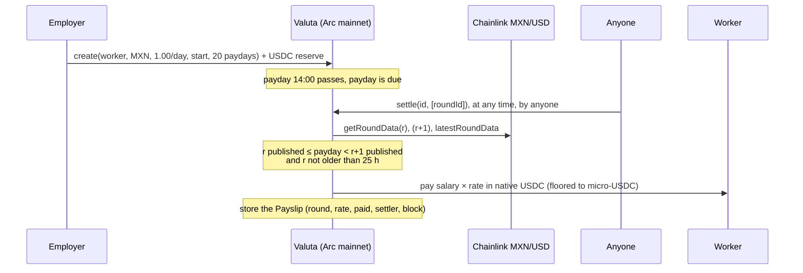

<div align="center">

# Valuta

[](https://explorer.arc.io/address/0x7d209Fbd9999C8fe37b4e6B3CCeF41DbbAF3252a)
[](https://repo.sourcify.dev/5042/0x7d209Fbd9999C8fe37b4e6B3CCeF41DbbAF3252a)
[-0B4F6C)](#tests)
[](https://studio.arc.io/app/ad133b3b-d828-4323-88f3-5be7b8f0bad4)
[](LICENSE)

### Salaries agreed in pesos, reais or euros, paid in USDC on Arc at the Chainlink rate that was live on payday, however late it settles and whoever settles it.

</div>

A contractor in Mexico City agrees to MXN 20,000 a month; the employer pays in dollars. Whoever converts, and *when*, decides what the contractor actually receives, and an employer who pays late can quietly wait for a better rate. Payroll platforms convert off-chain at their own rate and spread, so the worker can't check it either.

Valuta makes the rate a fact instead of a decision. Each payday is priced at the **Chainlink round that was live at that payday's timestamp**, proven on-chain from round history:
- that round was published before payday;
- the next round was published after it;
- the round was not stale.

Anyone can settle a payday, a week late or a minute late, and the amount is identical, because nobody chooses the rate. The employer can't pull the reserve while pay is due, and a shortfall becomes public arrears, never a silent skip. Every payslip is stored on-chain with its round id, so any payday can be checked with a single contract read.

**[The contract, verified ↗](https://explorer.arc.io/address/0x7d209Fbd9999C8fe37b4e6B3CCeF41DbbAF3252a)** · **[Arc Studio project ↗](https://studio.arc.io/app/ad133b3b-d828-4323-88f3-5be7b8f0bad4)** · **[Every Studio prompt ↗](prompts/)** · **[How it works](#how-it-works)** · **[Run it](#run-it-locally)**

---

## Proof: nothing here is a mockup

No demo mode, seeded database or fixtures. There is no backend: the chain is the only store, and every figure in the app is a contract read, a Chainlink answer or a block.

**The contract.** Valuta v2 at [`0x7d20…252a`](https://explorer.arc.io/address/0x7d209Fbd9999C8fe37b4e6B3CCeF41DbbAF3252a) on Arc mainnet: deploy [tx `0xdd69…f666`](https://explorer.arc.io/tx/0xdd694f2e94b9cbbff3ba2727e701519240473adee33d2006704fb6b3b409f666), block 27,804,867, **Sourcify exact match** for creation and runtime bytecode. No owner, no admin key, no pause and no upgrade path. Its source is byte-for-byte the file Arc Studio wrote.

**Ten paydays settled ten days late, by a stranger, each at its own rate.** Payroll 1 pays MXN 1.00 a day, with back pay from 15 Oct. A wallet with no connection to the payroll settled the first ten paydays in [one transaction](https://explorer.arc.io/tx/0x82ff6831bd4464228832d37afac96c968e5fe04fe9e0f2194d71ad1e0dd638b7) on 25 Oct. Same salary, ten different amounts, each priced at the round live at 14:00 UTC that day:

| Payday (14:00 UTC) | Chainlink round (published) | MXN/USD | Paid (USDC) | Settled | Late by |
|---|---|---|---|---|---|
| 15 Oct | 292 (15 Oct 13:50) | 0.05389760 | 0.053897 | 25 Oct 13:59 | 9d 23h 59m |
| 16 Oct | 297 (16 Oct 07:14) | 0.05441140 | 0.054411 | 25 Oct 13:59 | 8d 23h 59m |
| 17 Oct | 299 (16 Oct 15:49) | 0.05405639 | 0.054056 | 25 Oct 13:59 | 7d 23h 59m |
| 18 Oct | 301 (17 Oct 15:54) | 0.05407464 | 0.054074 | 25 Oct 13:59 | 6d 23h 59m |
| 19 Oct | 305 (19 Oct 13:54) | 0.05424758 | 0.054247 | 25 Oct 13:59 | 5d 23h 59m |
| 20 Oct | 308 (20 Oct 10:57) | 0.05407919 | 0.054079 | 25 Oct 13:59 | 4d 23h 59m |
| 21 Oct | 312 (21 Oct 13:39) | 0.05375477 | 0.053754 | 25 Oct 13:59 | 3d 23h 59m |
| 22 Oct | 321 (22 Oct 13:39) | 0.05360375 | 0.053603 | 25 Oct 13:59 | 2d 23h 59m |
| 23 Oct | 324 (23 Oct 13:39) | 0.05343964 | 0.053439 | 25 Oct 13:59 | 1d 23h 59m |
| 24 Oct | 325 (23 Oct 14:42) | 0.05362907 | 0.053629 | 25 Oct 13:59 | 23h 59m |
| 25 Oct | 326 (24 Oct 14:42) | 0.05356774 | 0.053567 | 25 Oct 14:10 | on time, settled by the employer |

The first ten were settled by a stranger in one transaction; the eleventh by the employer's keeper ten minutes after payday. All eleven are read back from the contract's `payslips` view, not from this table.

Round 293 was published at 14:06 on 15 Oct, six minutes after payday 1. Settling payday 1 against it would have paid 0.054080 instead of 0.053897. The contract refuses that by name: `NotAsOfPayday(payday, round)`. So does round 291.

**The ledger is one read.** `payslips(1, 0, 64)` returns every payslip, with its round, rate, amount, settler and settlement block, in a single `eth_call`. The settlement transaction comes from one single-block log query, never a scan.

**Refusals, by name**, captured from the live contract as read-only calls while payroll 2's 16:00 payday was due ([E-021](docs/EVIDENCE.md)):

| Attempt | Refused with |
|---|---|
| Price the payday at round 205 instead of its as-of round 206 | `NotAsOfPayday(1792944000, 205)` |
| Price it at round 207, which hadn't been published yet | `BadAnswer` |
| Employer reclaims the reserve while the payday is due | `UnsettledPaydays` |
| Reclaim more than the reserve | `InsufficientReserve` |
| A stranger reclaims someone else's reserve | `NotEmployer` |
| *Control:* settle with round 206 | succeeds |

**Any refusal can be replayed, at any time.** Arc's public RPC serves historical state, so an attempt can be re-run at the block before a payday was settled. At block 27,805,206, one block before the stranger's settlement, `settle(1, [round 293])` reverts `NotAsOfPayday(1792072800, round 293)`, and `settle(1, [round 292])` succeeds ([E-022](docs/EVIDENCE.md)).

**Lateness changes nothing, to the second.** Payroll 2 pays BRL 0.10 every two hours. Overnight on 26 Oct the builder's laptop slept, and its keeper settled four paydays at once at 06:46 UTC, up to 6 h 46 m late, in [one transaction](https://explorer.arc.io/tx/0xdd5ce0466ec0270f1d1e6573763b2dc4fff6b3a4c854925c5d77556fd8e5a190). Each still got its own round. The 00:00 payday paid at round 207, because round 208 was published sixteen seconds later, at 00:00:16. The 02:00, 04:00 and 06:00 paydays paid at round 208 ([E-024](docs/EVIDENCE.md)).

**It keeps running.** Payroll 3 pays EUR 0.01 a day until 4 Dec ([E-023](docs/EVIDENCE.md)). The builder's keeper settles paydays only while their laptop is on, and not at all after 28 Oct. From then on, due paydays wait with their amounts already fixed, and anyone can settle them.

Every mainnet transaction, with gas and receipts, is in [`docs/EVIDENCE.md`](docs/EVIDENCE.md).

---

## How it works



1. **A payroll** is a salary in local currency (18-decimal fixed point), a period, a number of paydays and a USDC reserve. The first payday may be up to 90 days in the past, which is back pay.
2. **The as-of rule.** For payday `t` and round `r`: `updatedAt(r) ≤ t`, the next round's `updatedAt` is after `t` (or `r` is the latest), and `t − updatedAt(r) ≤ 25 h`. If the round live at `t` was stale, the payday prices at the first round published after `t`. Anything else reverts `NotAsOfPayday`. The view `asOf(currency, t)` finds the round, so nobody has to.
3. **Settle** pays the next due paydays in order, up to 32 per call. The amount is `salary × answer / 1e8` (or `salary × 1e8 / answer` for USD/ARS), floored to whole micro-USDC.
4. **Payouts can't block a payroll.** The push to the worker carries a 50,000-gas stipend and no return-data copy; if it fails, the amount is credited to a withdrawable balance and the settlement still succeeds.
5. **The employer's limits.** `end` stops future paydays. `reclaim` refuses while any payday is due or arrears remain.

## Why this belongs on Arc

- **USDC is the native currency.** Reserves are plain payments, payouts are plain value transfers, and gas is paid in the unit the salary is paid in. A worker can claim with nothing but the USDC they were paid.
- **Chainlink FX feeds for eight currencies are live on Arc mainnet** (EUR, MXN, BRL, JPY, CAD, AUD, KRW, ARS), and their round history is readable on-chain: MXN/USD back to its first round on 11 June 2026.
- **Arc's value-transfer rules shaped the payout design.** A native transfer can revert even with enough balance (blocklist, zero address), so payouts fall back to credit. Amounts are floored to micro-USDC, so they're exact in both of Arc's USDC interfaces (18 decimals native, 6 through the ERC-20 view).
- **Deterministic finality.** A settled payday is final in under a second, with no reorg to undo a payslip.

## Built with Arc Studio

The contracts, tests, deploy and ops scripts, and the app were written by Arc Studio, driven from Claude Code through the Arc Studio CLI (`arc-studio run --session asof`). Nothing was hand-edited: every change went back through Studio. Every prompt sent is in [`prompts/`](prompts/), in order:

| Turn | What Studio did |
|---|---|
| [01](prompts/01-contracts.md) | Contract, TestFeed, 68 tests, three audit rounds (it fixed phase handling, `answeredInRound` and `startedAt` checks), testnet deploy |
| [02](prompts/02-hardening.md) | Capped-gas payouts (a worker contract could have locked the reserve), real mainnet deploy mode, fork test against live feeds |
| [03](prompts/03-rename-valuta-and-ops.md) | Renamed to Valuta; `Ops.s.sol` (create, fund, settleDue) |
| [04](prompts/04-onchain-payslips.md) to [06](prompts/06-checked-casts.md) | On-chain payslips, batch views, `duePreview`, packed into 4 slots, casts that revert instead of truncating |
| [07](prompts/07-app.md) | The app: ledger, proof inspector, data layer over Multicall3, routes |

Arc Studio deploys to Arc Testnet only. The mainnet deploy ran Studio's own `Deploy.s.sol` with Arc Foundry, and the source is identical to the Studio workspace (sha256 recorded in [`docs/EVIDENCE.md`](docs/EVIDENCE.md)).

## Tests

**96 passing** under Arc Foundry (`arc-forge test --network arc`, Arc's EVM semantics), including:
- the as-of rule: right round, earlier, later, latest, stale fallback both ways, zero and negative answers
- direct and inverse conversion, and micro-USDC flooring
- arrears, failed payouts (a gas-burning worker, a huge revert payload), reclaim refusals, `end`
- a stranger settling, and payslip storage written to exactly 4 slots
- `CastOverflow` instead of truncation, plus invariants and fuzzing
- **fork tests against the live MXN/USD and USD/ARS feeds on Arc mainnet**, including payslips matching events

## Limits

Naming these is cheaper than having a judge find them.

- **No audit.** Studio ran its audit subagents and Slither, and we reviewed the contract ourselves, but nobody independent has.
- **The demo payrolls are wallets the builder controls.** Every function is permissionless, so anyone can create a payroll or settle a due payday.
- **The fixing can lag the market.** Chainlink FX feeds here update on a 24-hour heartbeat or a 0.3–0.5% deviation, so a payday's rate can be up to 25 hours old. It is a published fixing, not an execution price.
- **Phase boundaries.** A payday that straddles a Chainlink aggregator phase change can't be proven by `settle` (`UnprovableRound`). All feeds are in phase 1 today.
- **Someone has to send the transaction.** A local keeper settles payrolls 1–3 while the builder's laptop is on, until 28 Oct. Any payday left unsettled waits as due and can be settled later by anyone, at the same amount.
- **Amounts are cents, not salaries**, because this is real money on mainnet.

## Run it locally

```bash
bun install
bun run dev                          # the app, reading Arc mainnet
arc-forge test --network arc         # 96 tests (fork tests use ARC_RPC_URL from .env)
```

## Repo

```text
contracts/          Valuta.sol, TestFeed.sol, tests, Deploy and Ops scripts (written in Arc Studio)
src/                the app: React, Vite, Tailwind, wagmi, viem (written in Arc Studio)
prompts/            every prompt sent to Arc Studio
docs/               STATE · PLAN · DECISIONS · EVIDENCE · CONTEXT
```

Why things are the way they are: [`docs/DECISIONS.md`](docs/DECISIONS.md).

<div align="center">

MIT · built for [Arc Microgrants 2: Built with Arc Studio](https://dorahacks.io/hackathon/arc-microgrants-2/detail) by [emmanuelist](https://github.com/emmanuelist)

</div>
